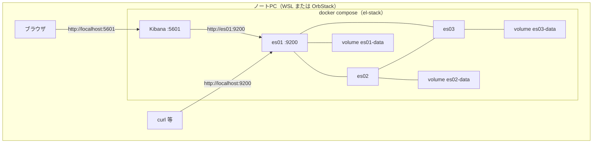
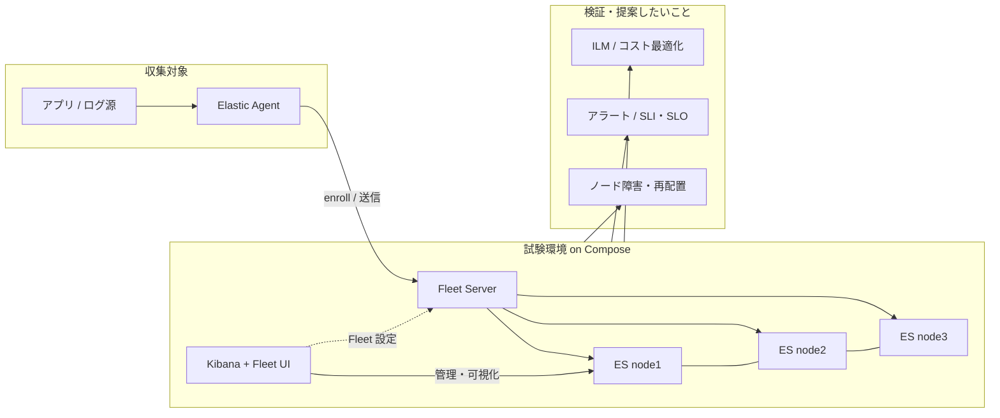

# 構成ポンチ絵（As-Is / To-Be）

Git 管理用。Mermaid（このファイル）と draw.io（`.drawio`）の両方を用意。  
要件の正本: [`zentai-keikaku.md`](./zentai-keikaku.md)

| 図 | 意味 | draw.io |
|----|------|---------|
| **As-Is（現状）** | いま動いているフェーズ1 | [`ponchi-e-as-is.drawio`](./ponchi-e-as-is.drawio) |
| **To-Be（ゴール）** | 本番との差分を減らした試験環境 | [`ponchi-e-to-be.drawio`](./ponchi-e-to-be.drawio) |

draw.io / diagrams.net / VS Code の Draw.io 拡張で `.drawio` を開いて編集できる。
---

## 1. As-Is（現状）— フェーズ1

### 要点

- Elasticsearch **3ノード** + Kibana（Compose）
- 版 **8.5.2**
- **Security OFF** / **Fleet なし**
- ホストから ES `9200`・Kibana `5601` を利用
- 実行: Windows WSL / Mac OrbStack

### 現状に無いもの（本番との主な差）

- 認証・TLS（Security）
- Fleet / Fleet Server / Elastic Agent
- 収集対象アプリからの継続的なデータ流入（本番相当）
- ILM・高度なアラート等の作り込み

---

## 2. To-Be（ゴール）— 本番トレース寄りの試験環境

### 要点

- 土台の 3ノード + Kibana は維持
- **Security ON**（認証・通信の保護）
- **Fleet + Fleet Server**（Agent の登録・ポリシー配信）
- 収集対象に **Elastic Agent** を置き、本番に近いデータ経路を再現
- その上で ILM / アラート / ノード障害試験など（SRE テーマ）

### ゴールで埋めたい「実環境との差分」

| 観点 | 現状 As-Is | ゴール To-Be |
|------|------------|--------------|
| 認証・TLS | OFF | ON（Security） |
| エージェント管理 | なし | Fleet + Fleet Server |
| データ収集 | ほぼ手確認中心 | Agent 経由の継続収集 |
| 運用検証 | クラスタ起動まで | ILM・アラート・障害試験 |

※ 試験環境はノート上の Compose。Elastic Cloud そのものの完全複製ではなく、**経路と機能のトレース**が目的。

---

## 3. 見るときの注意

- ポンチ絵はラフな意図共有用。IP や全環境変数は載せない
- As-Is は「今説明できる実機」、To-Be は「これから寄せる姿」
- 実装順は As-Is 完了 → Security → Fleet → 検証テーマ、が計画どおり

改訂: 2026-11-16（As-Is 稼働確認後に初版）
